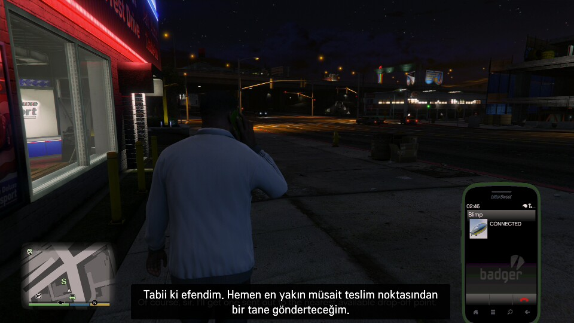
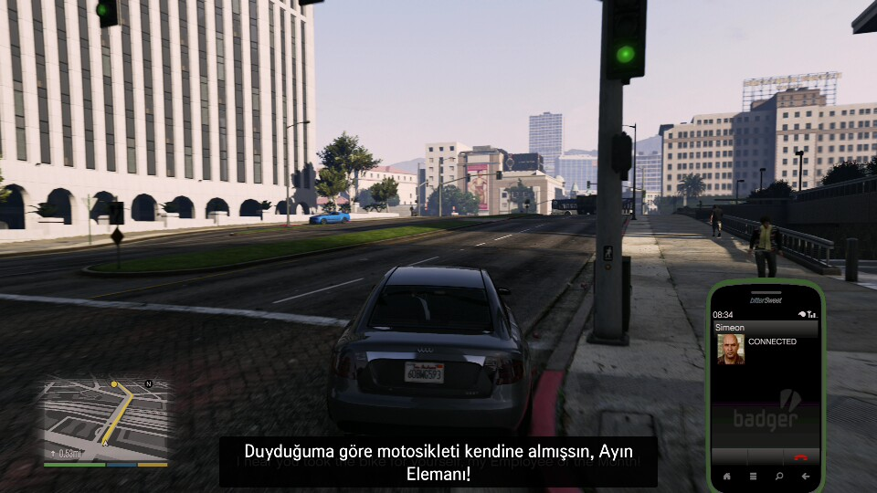
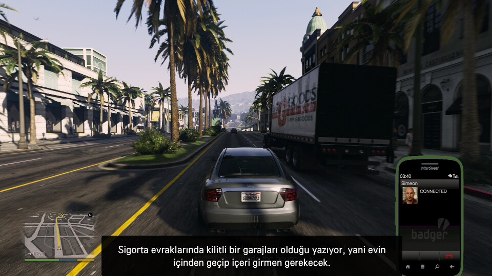
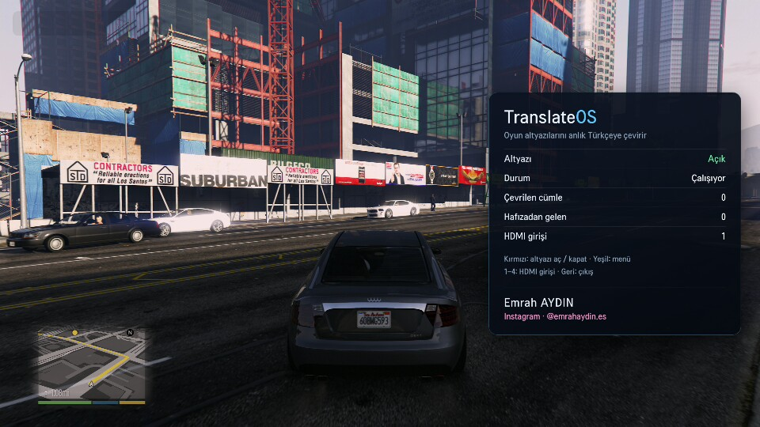

# TranslateOS: PS5 Oyunlarına TV'de Anlık Türkçe Altyazı (GTA 5 · GTA 6)

**TranslateOS**, LG webOS akıllı televizyonda çalışan, yapay zekâ destekli bir **gerçek zamanlı oyun altyazı çevirmenidir**. PlayStation 5'teki İngilizce oyunların altyazısını ekrandan okur, **Türkçeye çevirir** ve İngilizce altyazının tam üstüne yazar.

Bilgisayar, kamera, capture card ya da başka bir cihaz gerekmez. PS5 HDMI ile TV'ye bağlı kalır, her şey **televizyonun içinde** çalışır.

> GTA 5 Türkçe altyazı · GTA 6 Türkçe yama · PS5 Türkçe çeviri · LG TV oyun çevirmeni · yapay zekâ ile anlık altyazı



<p align="center">
  
  
</p>

*Ekran görüntüleri doğrudan TV'den alınmıştır: PS5'te GTA V, LG QNED TV, TranslateOS açık.*

---

## Neler yapıyor?

- 🎮 **Oyun TV'de, altyazı Türkçe.** PS5'te her zamanki gibi oynarsın; İngilizce altyazının yerinde Türkçesi görünür.
- 🧠 **Yapay zekâ ile okuma ve çeviri.** Altyazı bölgesi Google Gemini'ye gider; model tek istekte hem okur hem çevirir.
- 🔥 **Sansürsüz, doğal çeviri.** Sokak ağzı, argo ve küfür yumuşatılmadan, oyundaki sertliğiyle Türkçeye aktarılır. Çeviri yalnızca Türkçedir.
- ⚡ **Hızlı.** Altyazı göründükten yaklaşık 1–2 saniye sonra Türkçesi gelir. Aynı cümle ikinci kez çevrilmez, hafızadan gelir.
- 🕶️ **Sadece Türkçe görünür.** Türkçe altyazı İngilizcenin üstüne oturur. Yeni cümle geldiğinde kutu bir an yarı saydam olup yeni İngilizceyi okur, sonra Türkçesini yazar.
- 💾 **Cümle hafızası.** Çevrilen her cümle TV'de saklanır; aynı cümle her zaman aynı Türkçeyle çıkar.
- 📺 **Kumanda ile kontrol.** Kırmızı: altyazı aç/kapat · Yeşil: menü · 1–4: HDMI girişi · Geri: çıkış.
- 😴 **TV uyumaz.** Oyun sırasında ekran koruyucu ve uyku modu devreye girmez.

## TV menüsü

Yeşil tuşla açılır: altyazı durumu, çevrilen cümle sayısı, hafızadan gelenler, HDMI girişi.



## GTA 5 ve GTA 6

- **GTA 5 (GTA V):** PS5'te test edildi. Telefon görüşmeleri, görev konuşmaları ve çatışma sırasındaki diyaloglar çevriliyor.
- **GTA 6 (GTA VI):** TranslateOS oyuna özel değildir; ekranda İngilizce altyazı gösteren her oyunda çalışacak şekilde tasarlandı. GTA 6 çıktığında hedefimiz ilk günden Türkçe altyazıyla oynatmak.
- Altyazısı olan diğer PS5 oyunları da çalışmalı. Denediğin oyunları [bize bildir](../../issues).

## Nasıl çalışıyor?

```
PS5 ──HDMI──► LG TV ──► TranslateOS uygulaması (oyun görüntüsü + Türkçe altyazı katmanı)
                         │
                         └─► Arka plan servisi: ekran görüntüsü (saniyede ~2–3 kare)
                               → altyazı bölgesi değişti mi?
                               → Gemini: oku + Türkçeye çevir
                               → altyazıyı İngilizcenin üstüne yaz
```

Teknik ayrıntılar, ölçümler ve araştırma notları: [docs/ARASTIRMA.md](docs/ARASTIRMA.md)

## Desteklenen TV'ler

| TV | webOS | Durum |
|---|---|---|
| LG 55QNED7EB3C | webOS 26 (11.2.0) | ✅ Test edildi, çalışıyor |
| Diğer LG webOS TV'ler | 23 / 24 / 25 | 🟡 Henüz denenmedi |
| Eski LG webOS TV'ler | 4.x – 22 | 🟡 Henüz denenmedi |

Senin TV'n listede yoksa dene ve sonucu [issue olarak bildir](../../issues). Liste senin bildirimlerinle büyüyecek.

## Kurulum (geliştirici sürümü)

> Şu an kurulum geliştirici modu gerektiriyor. Herkesin tek tuşla kurabileceği kolay kurulum yol haritasında.

1. TV'de **LG Content Store**'dan **Developer Mode** uygulamasını kur, LG geliştirici hesabınla giriş yap, Dev Mode'u ve Key Server'ı aç.
2. Bilgisayarda:
   ```bash
   npm run setup
   ```
3. Ücretsiz bir **Gemini API anahtarı** al: [aistudio.google.com/apikey](https://aistudio.google.com/apikey). `service/config.local.json` dosyasına yaz:
   ```json
   { "geminiKey": "ANAHTARIN" }
   ```
4. TV'yi tanıt (`ares-setup-device`, cihaz adı `tv`) ve kur:
   ```bash
   npm run package && npm run install-tv && npm run launch-tv
   ```
5. İlk açılışta TV'de çıkan izin sorusunu onayla. Bu kadar.

## Yol haritası

- [ ] Tek tuşla kurulum (Homebrew Channel) ve resimli Türkçe kurulum rehberi
- [ ] API anahtarını TV'de QR kodla girme
- [ ] Ortak çeviri hafızası: bir kişinin çevirdiği cümle herkese anında ve ücretsiz gelsin
- [ ] Gecikmeyi 1 saniyenin altına indirmek
- [ ] Daha fazla TV modeli ve oyun testi

## Katkıda bulun ⭐

TranslateOS **geliştirmeye açık**. Kod, test, çeviri kalitesi, yeni TV modeli, yeni oyun; her katkı değerli.

- Projeyi beğendiysen **⭐ yıldız ver**. Daha çok kişiye ulaşmasını sağlar.
- Hata ya da öneri için [issue aç](../../issues).
- Kod katkısı için [CONTRIBUTING.md](CONTRIBUTING.md) dosyasını oku ve pull request gönder.

## Geliştirici

**Emrah AYDIN** · Instagram: [@emrahaydin.es](https://instagram.com/emrahaydin.es)

## Lisans

Copyright (C) 2026 Emrah AYDIN

TranslateOS, [GNU Affero Genel Kamu Lisansı v3.0 (AGPL-3.0)](LICENSE) ile yayınlanmıştır. Kodu kullanabilir, değiştirebilir ve paylaşabilirsin. Değiştirilmiş sürümü dağıtan ya da servis olarak sunan herkes kaynak kodunu aynı lisansla açmak ve bu telif bildirimini korumak zorundadır.

### Üçüncü taraf

- `service/registration.json`, `tv-service/registration.json`: TV eşleşme bildirimi, [aiowebostv](https://github.com/home-assistant-libs/aiowebostv) projesinden (Apache-2.0).
- [@jsquash/jpeg](https://github.com/jamsinclair/jSquash) (Apache-2.0), [jpeg-js](https://github.com/jpeg-js/jpeg-js) (BSD-3-Clause), [ws](https://github.com/websockets/ws) (MIT).
- Çeviri: Google Gemini API. Anahtar repoda tutulmaz.

---

TranslateOS bağımsız bir projedir. Rockstar Games, Take-Two Interactive, Sony Interactive Entertainment veya LG Electronics ile bağlantısı yoktur. GTA, Grand Theft Auto, PlayStation, PS5, LG ve webOS ilgili sahiplerinin ticari markalarıdır. Ekran görüntüleri yalnızca tanıtım amaçlıdır.

---

## English

**TranslateOS** is an AI-powered, real-time game subtitle translator that runs entirely on an LG webOS smart TV. It reads English subtitles from the PS5 (HDMI) picture, translates them into Turkish with Google Gemini, and draws the Turkish subtitle over the original one. No PC, camera or capture card is needed. Tested with GTA 5 on PS5, and built to work with GTA 6 and any game that shows subtitles. Contributions and ⭐ stars are welcome. Licensed under AGPL-3.0. Author: Emrah AYDIN ([@emrahaydin.es](https://instagram.com/emrahaydin.es)).
