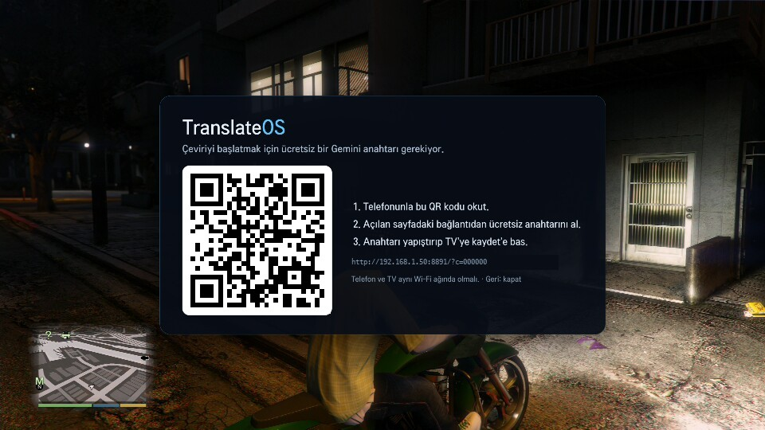

# TranslateOS kurulum rehberi

LG webOS TV'ye TranslateOS'u kurmak yaklaşık **15 dakika** sürer. Bir kez yapılır.

**Gerekenler:**
- LG webOS akıllı TV (test edilen: LG 55QNED7EB3C, webOS 26). Diğer modeller için [uyumluluk listesine](../README.md#desteklenen-tvler) bak.
- PS5 (ya da altyazılı oyun gösteren herhangi bir cihaz), TV'ye HDMI ile bağlı.
- Bilgisayar (Windows, Mac ya da Linux). Sadece kurulum için; sonra gerekmez.
- Telefon. Sadece Gemini anahtarını girmek için.
- TV, bilgisayar ve telefon **aynı Wi-Fi** ağında olmalı.

---

## 1. LG geliştirici hesabı (ücretsiz)

1. [webostv.developer.lge.com](https://webostv.developer.lge.com) adresine gir.
2. Sağ üstte **Sign In** › LG hesabınla giriş yap. Hesabın yoksa **Create Account** ile aç.

## 2. TV'de Developer Mode'u aç

1. TV'de **Apps** (LG Content Store) uygulamasını aç, **Developer Mode**'u ara ve kur.
2. Developer Mode'u aç, 1. adımdaki hesapla giriş yap.
3. **Dev Mode Status**'u **ON** yap. TV yeniden başlar.
4. Developer Mode'u tekrar aç, **Key Server**'ı **ON** yap.
5. Ekranda yazan **IP adresini** ve **Passphrase**'i (6 karakter) bir kenara not et.

> Developer Mode süreli çalışır. Ekrandaki süre dolmadan arada bir **Extend**'e bas. Süre dolarsa TranslateOS TV'den silinir; bu adımları tekrarlayıp yeniden kurman gerekir.

## 3. TranslateOS'u indir

[GitHub'daki son sürümden](https://github.com/emrah-aydin/TranslateOS/releases/latest) `com.translateos.app_..._all.ipk` dosyasını indir.

## 4. Bilgisayardan TV'ye kur

1. Ücretsiz **webOS Dev Manager** programını indir ve kur: [github.com/webosbrew/dev-manager-desktop/releases](https://github.com/webosbrew/dev-manager-desktop/releases)
2. Programı aç › **Add Device** (cihaz ekle).
3. TV'nin **IP adresini** ve **Passphrase**'i gir, kaydet.
4. **Apps** bölümüne geç ve indirdiğin `.ipk` dosyasını pencereye sürükle (ya da **Install**).
5. Kurulum bitince TV'nin uygulama listesinde **TranslateOS** görünür.

## 5. Gemini anahtarını telefonla gir

1. TV'de **TranslateOS**'u aç. Ekranda bir QR kod çıkar.

   

2. QR kodu telefonunun kamerasıyla okut.
3. Açılan sayfadaki bağlantıdan [aistudio.google.com/apikey](https://aistudio.google.com/apikey) adresine git, Google hesabınla giriş yap, **Create API key** ile ücretsiz anahtarını al ve kopyala.
4. Kurulum sayfasına geri dön, anahtarı yapıştır ve **TV'ye kaydet**'e bas.
5. TV'de "Anahtar kaydedildi" yazar. Anahtar sadece TV'nde saklanır.

## 6. İlk açılışta izin

İlk açılışta TV "bu uygulamaya izin verilsin mi?" diye sorar. **İzin ver**'e bas. TranslateOS, altyazıyı okuyabilmek için TV'nin ekran görüntüsüne ihtiyaç duyar. Bu soru sadece bir kez çıkar.

Bitti. PS5'te altyazılı bir oyun aç; İngilizce altyazılar Türkçe olarak oyunun üstünde görünür.

---

## Kumanda

| Tuş | Ne yapar |
|---|---|
| 🔴 Kırmızı | Altyazıyı aç / kapat |
| 🟡 Sarı | Türkçe İngilizcenin üstünde / İngilizcenin yerine |
| 🟢 Yeşil | Menü |
| 🔵 Mavi | Gemini anahtarını değiştir (QR ekranı) |
| Geri | Çıkış |

## Sorun giderme

- **QR kodu okutunca sayfa açılmıyor:** Telefon ve TV aynı Wi-Fi ağında olmalı. Misafir ağı ya da mobil veri çalışmaz.
- **"Bu TV ekran görüntüsü vermiyor" yazıyor:** TV modelin henüz desteklenmiyor olabilir. Lütfen modelini ve webOS sürümünü (Ayarlar › Genel › Cihaz › TV Bilgisi) [GitHub'da bildir](https://github.com/emrah-aydin/TranslateOS/issues).
- **Uygulama listeden kayboldu:** Developer Mode süresi dolmuş olabilir. 2. ve 4. adımları tekrarla.
- **Görüntü siyah kaldı:** Kumandadan giriş tuşuna (Input) basıp HDMI girişini yeniden seç.
